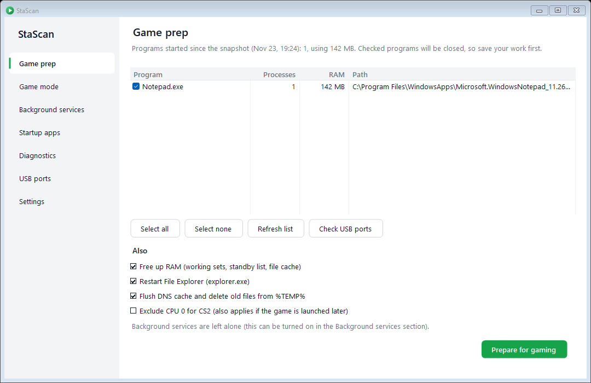
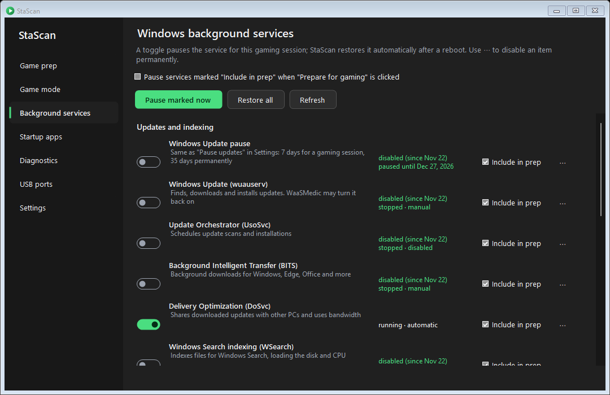
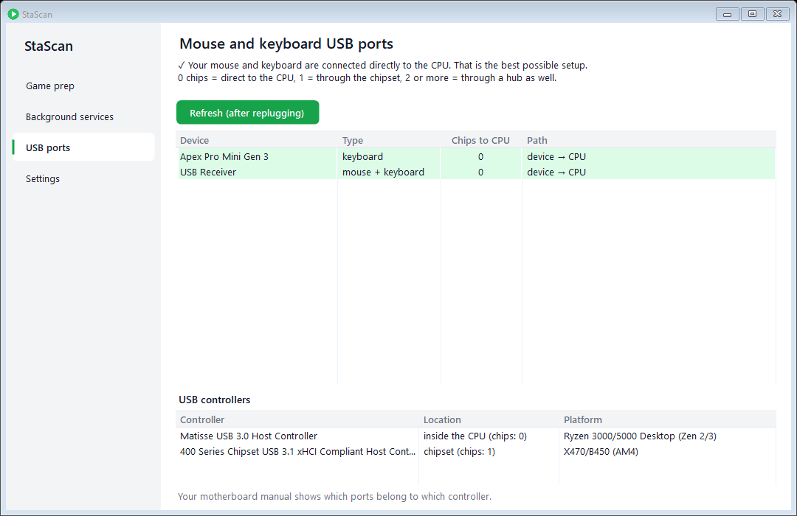
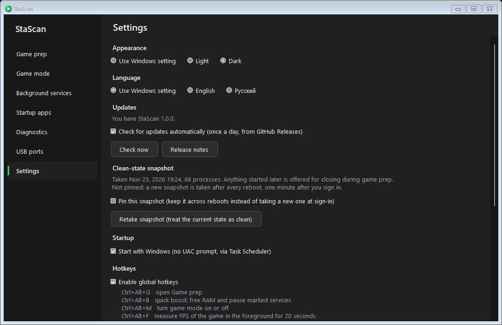
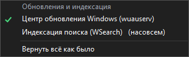

# StaScan

**Get your Windows PC back to a clean, game-ready state without rebooting.**

StaScan is a lightweight system tray utility for Windows 10 and 11. After a session of browsing, chatting and working, background processes, bloated memory caches and Windows housekeeping tasks often drag frame rates down until the next restart. StaScan takes a snapshot of your system right after you sign in. Later, one click closes everything started since then, flushes memory and quiets Windows background services so you can return to your game.



## Features

### Game prep
- **Clean-state snapshot.** At sign-in StaScan records which processes are running and treats them as the baseline. You can **pin** a snapshot in Settings to keep it across reboots: StaScan then compares against that saved state every time instead of taking a new snapshot at sign-in. Processes are matched by executable path, so a pinned snapshot stays valid after a restart.
- **Close what was opened later.** Every program started after the snapshot is listed with its process count and memory usage. Checked programs are first asked to close gracefully. Anything still running after 5 seconds is terminated.
- **Memory cleanup.** Empties process working sets, flushes the modified page list and the file system cache, and purges the standby list (the same operations as RAMMap's *Empty* commands or ISLC).
- **Explorer restart.** Restarts `explorer.exe` and the taskbar without elevated rights.
- **DNS and temp cleanup.** Flushes the DNS resolver cache and deletes files older than 24 hours from `%TEMP%`.
- **CS2 affinity.** Optionally removes CPU 0 from the affinity mask of `cs2.exe`. This also applies when the game is launched later.
- **Driver leak hint.** The summary shows the size of the kernel nonpaged pool, so you can tell when only a reboot will help (see [Troubleshooting](#troubleshooting)).

### Game mode
Turn it on in the **Game mode** section or from the tray menu, and StaScan does the prep for you:

- **Watches for games.** It checks every few seconds for any executable from your game list (`cs2.exe` by default). You can add a running program in one click.
- **Prepares automatically.** When a game starts, StaScan frees RAM and pauses the background services marked *Include in prep*. Closing other programs is optional and off by default, because it happens without confirmation.
- **Cleans up after you.** When the last game exits, everything game mode paused is restored.

### FPS measurement
Check whether game prep actually helps. Press `Ctrl+Alt+F` while playing and StaScan records the game in the foreground for 20 seconds, then shows the average FPS and 1% low, compared with the previous measurement. Measurements are listed in the **Game mode** section, marked when game prep ran in between. FPS is captured with [Intel PresentMon](https://github.com/GameTechDev/PresentMon) (MIT), which StaScan downloads once on request (about 1 MB) and verifies by SHA-256.

### Background services
Pause or disable Windows components that compete with your game for CPU, disk and network:

| Group | Items |
|---|---|
| Updates and indexing | Windows Update pause (same as *Pause updates* in Settings), `wuauserv`, `UsoSvc`, `BITS`, Delivery Optimization (`DoSvc`), Windows Search (`WSearch`) |
| Telemetry and maintenance | `DiagTrack`, Compatibility Appraiser, CEIP, disk diagnostics, scheduled drive optimization, Automatic Maintenance |
| Other | `SysMain` (Superfetch), Xbox Game Bar background recording |

Each item has its own toggle in the main window and in the tray menu:

- **For this gaming session.** The item is paused until you turn it back on. If you forget, StaScan restores it automatically after the next reboot.
- **Permanently.** The item stays disabled until you restore it.
- **Restore all.** StaScan remembers the original state of every item it changes and restores exactly that state.
- **Changed outside StaScan.** Items disabled elsewhere are labelled *disabled in Windows*. Turning them on applies the Windows default.

Microsoft Defender is intentionally never touched.



### Startup apps
See what starts with Windows and uncheck what you do not need. StaScan reads the `Run` registry keys (per user, all users, 32-bit) and both Startup folders. It disables items the same way Task Manager does, by marking them under `Explorer\StartupApproved`, so nothing is deleted and every item can be turned back on from StaScan or from Task Manager. Microsoft Store apps and programs started by scheduled tasks are not listed yet.

### Diagnostics
Find out *why* the frame rate dropped instead of guessing:

- **Memory trends.** Available RAM and the kernel nonpaged pool are sampled once a minute and charted for the last 24 hours.
- **Driver leak finder.** Kernel pool usage per allocation tag (like `poolmon`) with growth since StaScan started. Select a tag and StaScan finds which loaded driver uses it. A warning appears when the nonpaged pool grows faster than 20 MB per hour.
- **Video memory by process.** Dedicated GPU memory per process. Browsers, chat apps and animated wallpapers often hold hundreds of megabytes of VRAM while minimized.

### USB port check
Shows how many chips (hubs and the chipset) sit between your mouse or keyboard and the CPU, and whether your motherboard has USB ports wired directly to the processor:

- **0 chips:** connected directly to the CPU.
- **1 chip:** through the chipset.
- **2 or more:** through a hub as well (monitor, keyboard or front-panel hubs).



### Interface
- A single main window with four sections: Game prep, Background services, USB ports and Settings.
- **Themes.** Light and dark themes, or follow the Windows app theme automatically.
- **Languages.** English and Russian; by default the Windows display language is used. Translations live in [`assets/i18n`](assets/i18n), keyed by the English text, so adding a language means adding one JSON file.
- **Tray menu.** Quick access to every action, including a per-service toggle submenu.
- **Global hotkeys** (can be turned off in Settings):

  | Keys | Action |
  |---|---|
  | `Ctrl+Alt+G` | Open Game prep |
  | `Ctrl+Alt+B` | Quick boost: free RAM and pause marked services, nothing is closed |
  | `Ctrl+Alt+M` | Turn game mode on or off |
  | `Ctrl+Alt+F` | Measure FPS of the game in the foreground for 20 seconds |
- **Small footprint.** About 20 MB of RAM and near-zero CPU while idle in the tray. Memory is returned to the system when the window is closed.

| Settings | Tray submenu |
|---|---|
|  |  |

## Requirements

- Windows 10 1809 or later, or Windows 11, 64-bit
- An administrator account. StaScan runs elevated so that it can close other processes, purge the standby list and manage services.
- No .NET installation is needed: the release build is self-contained.

## Installation

Download the latest **StaScan-Setup-x.y.z.exe** from [Releases](https://github.com/turq-co/stascan/releases/latest) and run it. The installer:

- installs StaScan to `C:\Program Files\StaScan` and adds a Start menu shortcut;
- optionally starts StaScan when you sign in. This creates a Task Scheduler task named `StaScan` that runs with highest privileges 60 seconds after sign-in, so there is no UAC prompt and the snapshot is taken once your startup apps have settled;
- makes the tray icon always visible on Windows 11 the first time StaScan starts (you can still hide it in **Settings → Personalization → Taskbar → Other system tray icons**).

StaScan checks GitHub Releases for a newer version once a day (Settings → Updates; the request contains no personal data and can be turned off). **Download and install** fetches the installer, verifies its SHA-256 checksum against the release, and upgrades in place while keeping your options. You can also run a newer installer over the existing installation yourself. A **portable** zip with a single `StaScan.exe` is also attached to each release.

The builds are not code-signed, so Windows SmartScreen may show a warning: click **More info → Run anyway**. If Smart App Control is turned on, Windows may block unsigned apps entirely; you will then see event ID 3077 in the `Microsoft-Windows-CodeIntegrity/Operational` log.

### Building from source

Requires the [.NET 8 SDK](https://dotnet.microsoft.com/download/dotnet/8.0) (`winget install Microsoft.DotNet.SDK.8`) and, for the installer, [Inno Setup 6](https://jrsoftware.org/isinfo.php) (`winget install JRSoftware.InnoSetup`).

```powershell
git clone https://github.com/turq-co/stascan.git
cd stascan
.\build.ps1
```

This produces `dist\StaScan.exe` and, when Inno Setup is installed, `dist\StaScan-Setup-<version>.exe`.

### Publishing a release

Releases are built by GitHub Actions: bump `<Version>` in `StaScan.csproj` and push a matching `v*` tag. Every push and pull request is also built and checked for missing translations. See [docs/PUBLISHING.md](docs/PUBLISHING.md) for releases, winget packaging and code signing.

## Usage

| Where | What it does |
|---|---|
| Double-click the tray icon | Opens the main window on Game prep |
| **Game prep** | Review the list of new programs, choose extra actions, click **Prepare for gaming** |
| **Background services** | Toggle individual services. The **Include in prep** checkbox adds a service to the Game prep run, provided the option at the top of the section is enabled |
| **USB ports** | Replug a device and click **Refresh** to see the result |
| **Settings** | Theme, snapshot (retake or pin across reboots), autostart, whitelist, log folder |
| Tray menu → **Background services ▸** | Toggle any service in one click, disable permanently, or restore all |

Settings, the snapshot and the log are stored in `%LOCALAPPDATA%\StaScan`.

## Safety

StaScan never closes:

- processes in other sessions, or Windows services;
- anything located under `C:\Windows`;
- critical system processes (`csrss`, `dwm`, `svchost`, `explorer` and others);
- processes whose executable path cannot be read;
- programs on the whitelist (Steam, Discord, NVIDIA, Epic Games, Battle.net, OBS, MSI Afterburner/RTSS are included by default);
- StaScan itself.

## Limitations

- If you use a standard account and enter **another** administrator's credentials at the UAC prompt, StaScan runs as that administrator. Its settings and log then live in that profile, and the Xbox Game Bar option changes that user's settings, not yours.
- The USB controller table covers common Intel and AMD platforms. An unknown controller is shown as *not in database* and treated as chipset-attached.
- CS2 and some anti-cheat systems (for example FACEIT) may block changes to process affinity. StaScan reports a warning when this happens.

## Troubleshooting

The Game prep summary includes the **nonpaged pool** size. It is usually 300–800 MB. If it exceeds 1.5 GB and keeps growing between sessions, a driver is most likely leaking kernel memory. Network, RGB lighting, anti-cheat and outdated GPU drivers are common causes. No user-mode tool can reclaim that memory. Update or remove the offending driver; `poolmon` from the Windows Driver Kit can help identify it.

## Uninstalling

Uninstall StaScan from **Settings → Apps → Installed apps**. The uninstaller stops StaScan, restores every background service it paused or disabled, and removes its scheduled tasks. Your settings and log stay in `%LOCALAPPDATA%\StaScan`; delete that folder if you no longer need them.

For the portable version: **Background services → Restore all**, **Settings →** turn off **Start with Windows**, exit StaScan from the tray menu, then delete `StaScan.exe` and `%LOCALAPPDATA%\StaScan`.

## License

StaScan is licensed under the [GNU General Public License v3.0](LICENSE). You may use, study, modify and redistribute it; derivative works must also be released under GPL-3.0.

## Acknowledgements

The USB port check is based on [cpu-direct-usb](https://github.com/MariusHeier/cpu-direct-usb) by Marius Heier (MIT). See [THIRD_PARTY_NOTICES.md](THIRD_PARTY_NOTICES.md).
